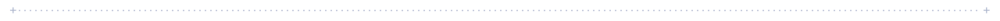
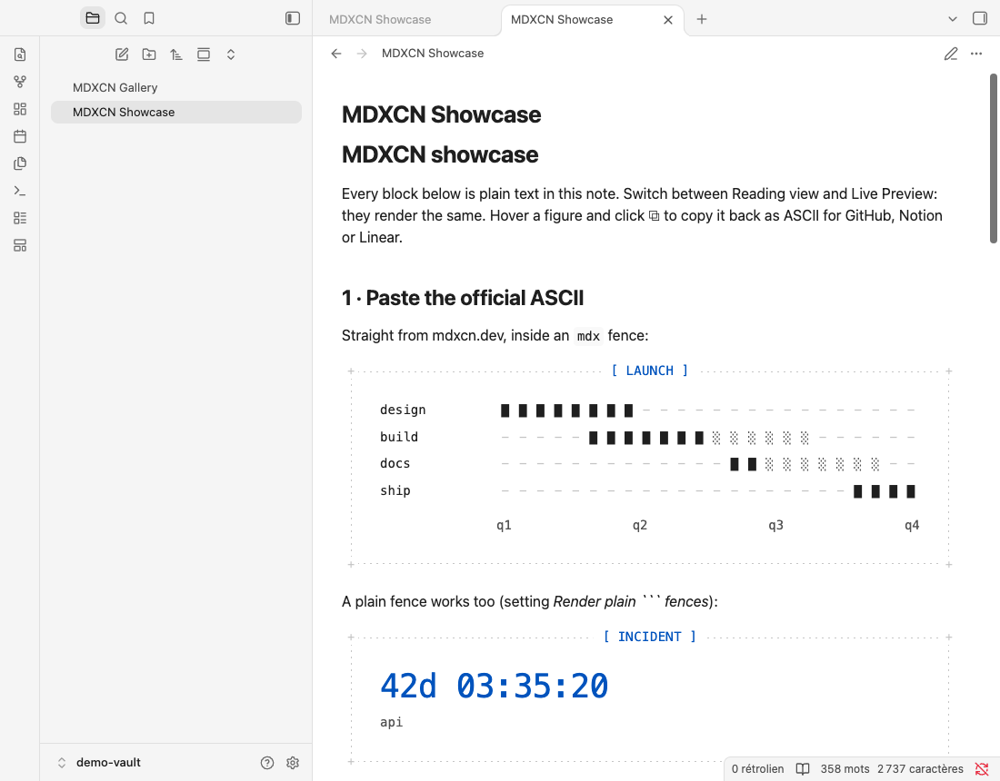
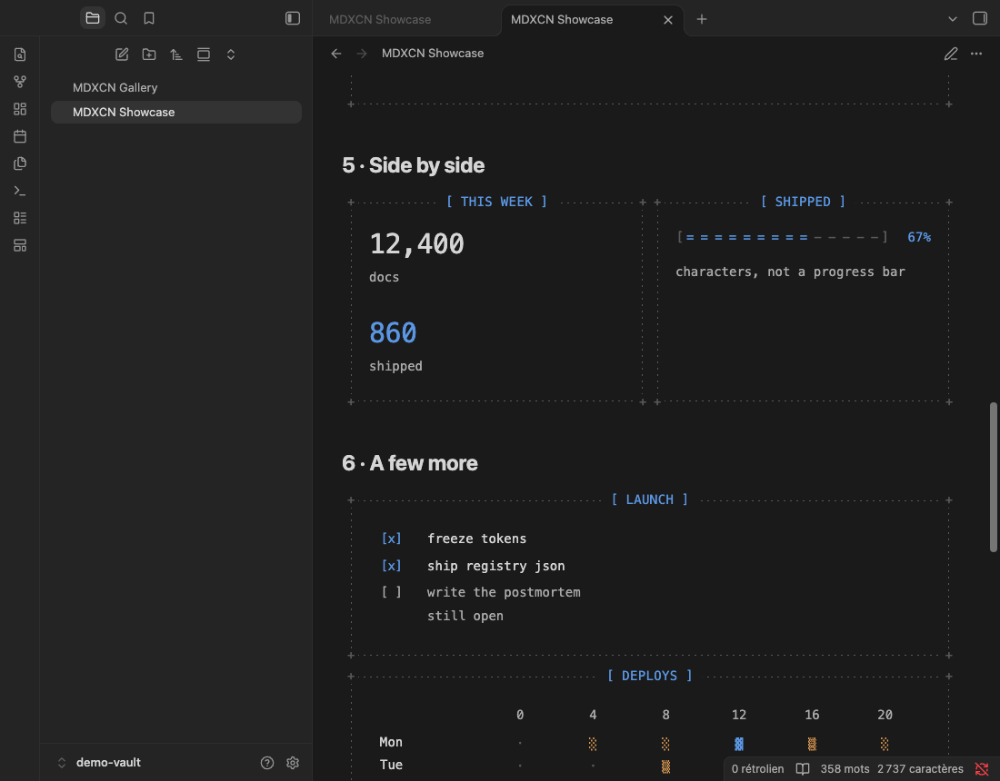
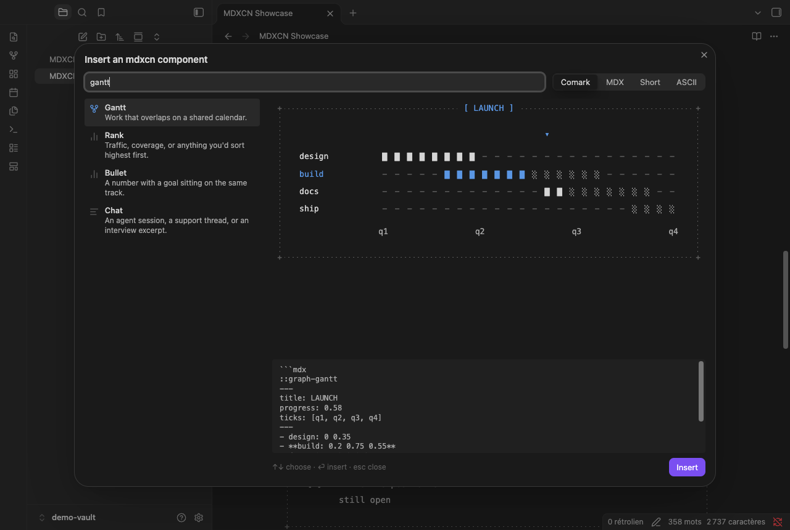

<p align="center">
  <picture><source media="(prefers-color-scheme: dark)" srcset="docs/assets/hero-dark.svg"></picture>
</p>

<p align="center">
  <b>The framed text figures of <a href="https://mdxcn.dev">mdxcn.dev</a>, native in Obsidian.</b><br>
  Paste the official ASCII, an MDX tag or a Comark block in a note: it renders.<br>
  Gantt, timeline, live timers and countdowns, tables, charts, callouts… all 46 mdxcn components, plus a plain Frame.
</p>

<p align="center">
  <a href="https://github.com/M-U-C-K-A/MDXCN-obsidian/releases/latest"></a>
  <a href="https://github.com/M-U-C-K-A/MDXCN-obsidian/releases"></a>
  <a href="https://github.com/M-U-C-K-A/MDXCN-obsidian/actions/workflows/ci.yml"></a>
  
  
  
</p>

<p align="center">
  <a href="https://github.com/M-U-C-K-A/MDXCN-obsidian/releases/latest/download/mdxcn.zip"></a>
</p>

<p align="center">
  <a href="#quick-start">Quick start</a> ·
  <a href="#four-ways-to-write-a-figure">Syntaxes</a> ·
  <a href="#insert-a-component-in-two-keystrokes">Templates</a> ·
  <a href="#your-contrast-color">Colors</a> ·
  <a href="#the-components">Components</a> ·
  <a href="#install">Install</a> ·
  <a href="#development">Development</a>
</p>

<picture><source media="(prefers-color-scheme: dark)" srcset="docs/assets/divider-dark.svg"></picture>

## Quick start

Copy any fenced drawing from [mdxcn.dev](https://mdxcn.dev) into a note, inside an `mdx` fence:

````markdown
```mdx
+------------------- [ LAUNCH ] -------------------+
|                                                  |
| design  ████████----------------                 |
| build   -----███████░░░░░░------                 |
| docs    -------------██░░░░░░░--                 |
| ship    --------------------████                 |
|         q1     q2      q3     q4                 |
|                                                  |
+--------------------------------------------------+
```
````

…and Obsidian draws the live figure: dotted frame, `+` corners, `[ TITLE ]`, the accent on the current row, the fade-up when it scrolls into view. Reading view and Live Preview alike.

<p align="center">
  
  
</p>

> [!TIP]
> No language at all? A plain ` ``` ` fence that holds an mdxcn frame renders too (setting *Render plain fences*, on by default). Notes written for GitHub stay readable everywhere, and look native in Obsidian.

<picture><source media="(prefers-color-scheme: dark)" srcset="docs/assets/divider-dark.svg"></picture>

## Paste it, it renders

<p align="center"><picture><source media="(prefers-color-scheme: dark)" srcset="docs/assets/pipeline-dark.svg"></picture></p>

The plugin reads the drawing back into data. Each official fence has a fingerprint (`[====---]` is Rank, rows ending in `█░-` are Gantt, `●` with `│` is Timeline, `2026-08-27T08:00:00Z — api` is a Timer…), so the type is found on its own. Drawing it again gives the **exact** same characters: the 39 official ASCII samples round-trip byte for byte in the test suite.

Timers are live. This block ticks every second:

````markdown
```mdx
+----------------- [ INCIDENT ] -----------------+
|                                                |
| 2026-08-27T08:00:00Z — api                     |
|                                                |
+------------------------------------------------+
```
````

A date in the past is a **Timer** (elapsed: `42d 02:38:32`), a date in the future is a **Countdown**. Words like *until*, *freeze*, *deadline* or *since* in the caption or title decide when you want to be explicit.

<picture><source media="(prefers-color-scheme: dark)" srcset="docs/assets/divider-dark.svg"></picture>

## Four ways to write a figure

<p align="center"><picture><source media="(prefers-color-scheme: dark)" srcset="docs/assets/syntaxes-dark.svg"></picture></p>

ASCII is great to paste, not to write. The other three use mdxcn's **Markdown children**: a list, a table or a few lines, the way you would write them anyway.

<table>
<tr><th>Syntax</th><th>What it looks like</th></tr>
<tr><td><b>Comark</b><br><sub>official · recommended</sub></td><td>

````markdown
```mdx
::graph-gantt
---
title: LAUNCH
progress: 0.58
ticks: [q1, q2, q3, q4]
---
- design: 0 0.35
- **build: 0.2 0.75 0.55**
- docs: 0.55 0.9 0.2
- ship: 0.85 1 0
::
```
````

</td></tr>
<tr><td><b>MDX</b><br><sub>official</sub></td><td>

````markdown
```mdx
<GraphTimeline title="NIGHT">

- 14:02: p95 crossed 800ms — paged the on-call
- **14:11: rolled back the cache flag**
- *14:40: write the postmortem*

</GraphTimeline>
```
````

</td></tr>
<tr><td><b>Short</b><br><sub>plugin shortcut</sub></td><td>

````markdown
```mdx countdown
2027-01-01T00:00:00Z — until launch
```
````

</td></tr>
<tr><td><b>ASCII</b><br><sub>official fence</sub></td><td>

The drawing itself, as above. Also what **Copy as ASCII** produces for GitHub, Notion, Linear or Slack.

</td></tr>
</table>

All of mdxcn's grammar works, in every syntax:

| Write | Means |
| --- | --- |
| `**bold**` | now, chosen, the total, the row to read. Gets the accent. |
| `*italic*` | next, rejected, an aside. Recedes. |
| `- label: value` | one row. The label is everything before the first `: `. |
| `x — note` | a side note, a reason or a caption. |
| `a → b → c` | a path (`->` works too). |
| `- [x] done` | a box; `[ ]` is open. |
| nested list | children: sub-tasks, folders. |
| `### heading` | a section, a column or a question. |
| `\| table \|` | data. A last row in **bold** or starting `Total` is the footer. |
| ` ``` fence ``` ` | raw lines; `// (1)` marks a line for Annotate. |
| `~~old~~ new` | a rewrite (Diff). |
| `ok*40` | a run: forty of them (Uptime, Activity, Spark…). |

Item tags (`<Span start={0} end={0.35}>design</Span>`, `<Stat value="12" label="docs" />`…), YAML props (`palette: duo`, `glyphs: ascii`, `corner: "·"`), and side-by-side rows (`::row{cols=2}` or `<GraphRow cols={2}>`) work too. Gantt also accepts plain units (`- build: 2 9` in weeks) and scales them.

<picture><source media="(prefers-color-scheme: dark)" srcset="docs/assets/divider-dark.svg"></picture>

## Insert a component in two keystrokes

Nobody should type a frame by hand. Pick a component, get a filled-in template, edit the Markdown.

| How | What happens |
| --- | --- |
| Type **`::`** at the start of a line, then a name (`::gan`, `::timer`) | an inline suggester inserts the whole block |
| Click the **ribbon icon** or run **MDXCN: Insert component…** | the picker opens: search, live preview, choose the syntax with <kbd>Tab</kbd>, <kbd>Enter</kbd> inserts |
| **Slash commands** (`/Insert Gantt`) or the command palette | one command per component (can be turned off) |
| Right-click in the editor | *Insert mdxcn component…*, and *Convert* when the cursor is in a block |
| **MDXCN: Create a gallery note** | a note with all 47 components, ready to copy from |

<p align="center"></p>

When the cursor is already inside an `mdx` block, only the inner part is inserted, and the fence is lengthened (```` ```` ````) if the template carries its own code fence.

<picture><source media="(prefers-color-scheme: dark)" srcset="docs/assets/divider-dark.svg"></picture>

## Your contrast color

<p align="center"><picture><source media="(prefers-color-scheme: dark)" srcset="docs/assets/accent-dark.svg"></picture></p>

mdxcn uses one accent: the current row, the playhead, the fill, the live timer. **Settings → MDXCN** lets you choose it:

- **Presets** — mdxcn blue, amber, green, teal, red, orange, purple, pink (each with a light and a dark shade);
- **Obsidian accent** — follows your theme;
- **Custom** — two color pickers, one for light mode, one for dark mode;
- **Palette** — *mono* (one accent, mdxcn's default), *duo* or *multi* add a second and third color to series and secondary states. A block can override it with `palette: duo`.

Also in the settings: border style (dotted, dashed, solid, none), corner glyph, font (e.g. `"Geist Mono"`), text size, animations, the plain-fence rendering, the hover toolbar, the default template syntax and the suggester trigger. A live preview at the top of the tab shows every change. Everything is a CSS variable, so snippets can go further:

```css
body { --mdxcn-accent-light: #e5484d; --mdxcn-accent-dark: #ff9592; }
.mdxcn-graph { --mdxcn-bg: var(--background-secondary); }
```

<picture><source media="(prefers-color-scheme: dark)" srcset="docs/assets/divider-dark.svg"></picture>

## Copy back, convert in place

Hover a figure: **⧉** copies it as the official ASCII fence (GitHub, Notion, Linear and Slack render it as is). The **⋯** menu copies it as MDX or Comark, or **converts the block in place**. The same conversions are commands that act on the block under the cursor:

- *Convert block under cursor to ASCII / MDX / Comark*
- *Copy block under cursor as ASCII*

So you can write in Comark, and publish the README version with one command.

<picture><source media="(prefers-color-scheme: dark)" srcset="docs/assets/divider-dark.svg"></picture>

## The components

<p align="center"><picture><source media="(prefers-color-scheme: dark)" srcset="docs/assets/catalog-dark.svg"></picture></p>

Every block is named by its registry slug (`graph-gantt`), its MDX tag (`GraphGantt`) or a short alias (`gantt`, `kanban`, `todo`, `shell`, `adr`…). The tables are generated from the plugin's registry (`npm run docs`).

<!-- catalog:start -->
<details>
<summary><b>Content</b> · 12</summary>

| Component | Names | Use it for | Markdown children (start) |
| --- | --- | --- | --- |
| **Callout** | `::callout` · `Callout` | An aside the reader should not skip: a caveat, a tip, a breaking change. | ``The CLI copies files into `registry/default`. Edit the so…`` |
| **Quote** | `::quote` · `Quote` | One sentence someone else said, with a name under it. | `A thousand barely audible voices all singing in tune.` |
| **Steps** | `::steps` · `Steps` | A procedure (install, migrate, release) with one step marked now. | `1. Copy the source` |
| **Terminal** | `::terminal` · `Terminal` | A command and what it printed. | `$ pnpm dlx shadcn@latest add @mdxcn/all` |
| **Changelog** | `::changelog` · `Changelog` | One release: what was added, changed, fixed, removed. | `- added: Board, Score, Chat, Env, Endpoint, Keys, FAQ` |
| **Annotate** | `::annotate` · `Annotate` | A code sample where a few lines need explaining. | `def fetch(url, times=3):  # (1)` |
| **Decision** | `::decision` · `Decision` | An ADR or a tradeoff: what you picked, what you didn't, and why. | `- **Postgres** — we already run it` |
| **Chat** | `::chat` · `Chat` | An agent session, a support thread, or an interview excerpt. | `- you: which graph shows a rollback?` |
| **Env** | `::env` · `Env` | The variables a project needs, which are required, and what they do. | `# Postgres connection string. Required.` |
| **Endpoint** | `::endpoint` · `Endpoint` | One API route: method, path, params, a response. | `GET /api/v1/components/:slug` |
| **Keys** | `::keys` · `Keys` | Keyboard shortcuts, a cheat sheet, or a key combo in a tutorial. | `- **⌘K: search the docs**` |
| **FAQ** | `::faq` · `Faq` | Questions people keep asking, with the answer under each. | `### Is this an npm package?` |

</details>

<details>
<summary><b>Data</b> · 9</summary>

| Component | Names | Use it for | Markdown children (start) |
| --- | --- | --- | --- |
| **Table** | `::graph-table` · `GraphTable` | Numbers that belong in a spreadsheet. | `\| Agent \| Tokens \| Tool calls \| Time \|` |
| **Sheet** | `::graph-sheet` · `GraphSheet` | A table with section titles, like an API, an RFC, or a spec with groups. | `### Scope` |
| **Compare** | `::graph-compare` · `GraphCompare` | Two options side by side. | `\| \| Solo \| Studio \|` |
| **Matrix** | `::graph-matrix` · `GraphMatrix` | Both axes are labels and the cells are exact numbers. | `\| \| Pos \| Neg \|` |
| **Invoice** | `::graph-invoice` · `GraphInvoice` | From, bill-to, line items, and totals. | `- No.: 0041` |
| **Spec** | `::graph-spec` · `GraphSpec` | Aligned label and value rows, like a spec sheet. | `- Family: Geist Mono` |
| **Stat** | `::graph-stat` · `GraphStat` | Two to four large numbers, with no sparkline. | `- 12,400 docs` |
| **KPI** | `::graph-kpi` · `GraphKpi` | One number is the headline and the rest is context. | `12,400 this week — +18%` |
| **Diff** | `::graph-diff` · `GraphDiff` | What was added, removed, or kept. | `- vendor: 84 kb` |

</details>

<details>
<summary><b>Charts</b> · 16</summary>

| Component | Names | Use it for | Markdown children (start) |
| --- | --- | --- | --- |
| **Bars** | `::graph-bars` · `GraphBars` | A before and after, or any two small histograms. | `- before: 2 4 3 5 2` |
| **Rank** | `::graph-rank` · `GraphRank` | Traffic, coverage, or anything you'd sort highest first. | `- 12,400 /docs` |
| **Cells** | `::graph-cells` · `GraphCells` | A small grid of filled and empty cells. | `- fragments: 1 0 1 0 0 / 0 1 0 1 0 / 1 0 0 0 1` |
| **Meter** | `::graph-meter` · `GraphMeter` | One value between 0 and 1, shown as a fill. | `67% — characters, not a progress bar` |
| **Spark** | `::graph-spark` · `GraphSpark` | A handful of numbers when you don't need an axis. | `2 3 4 3 6 5 8 7 9 6 10 8 — last point is the accent` |
| **Stack** | `::graph-stack` · `GraphStack` | Parts of a whole on one track. | `- marketing: 48 js, 22 css, 30 images` |
| **Funnel** | `::graph-funnel` · `GraphFunnel` | Steps that get narrower as people drop off. | `- 12,400 docs` |
| **Plot** | `::graph-plot` · `GraphPlot` | A series that needs a y-scale. | `2 3 3 5 4 7 6 8 5 9 7 6` |
| **Waffle** | `::graph-waffle` · `GraphWaffle` | A share shown as a grid of about a hundred cells. | `73% — 73 of 100 tests green` |
| **Waterfall** | `::graph-waterfall` · `GraphWaterfall` | A running total as floating bars. | `- Revenue: 48` |
| **Slope** | `::graph-slope` · `GraphSlope` | A before and after number on each row. | `- docs: 8,200 → 12,400` |
| **Bullet** | `::graph-bullet` · `GraphBullet` | A number with a goal sitting on the same track. | `- Design: 42 / 40` |
| **Score** | `::graph-score` · `GraphScore` | A review, an eval, or a vendor pick scored out of five. | `- Performance: 4/5` |
| **Heatmap** | `::graph-heatmap` · `GraphHeatmap` | A labeled grid of intensities. | `\| \| 0 \| 4 \| 8 \| 12 \| 16 \| 20 \|` |
| **Activity** | `::graph-activity` · `GraphActivity` | Daily counts over months, like a contribution grid. | `- 2026-06-01: 3 7 0 12 4 0 0 5 8 2 9 1 0 0 6 4 11 3 7 0 0…` |
| **Uptime** | `::graph-uptime` · `GraphUptime` | A status per day, or the blast radius of an outage. | `ok*18 degraded ok*22 down*2 ok*30 degraded ok*16` |

</details>

<details open>
<summary><b>Diagrams</b> · 6</summary>

| Component | Names | Use it for | Markdown children (start) |
| --- | --- | --- | --- |
| **Flow** | `::graph-flow` · `GraphFlow` | A pipeline, a request path, or walking through a change. | `- tap → server → update` |
| **Tree** | `::graph-tree` · `GraphTree` | Nested files or an org chart. | `- registry/default` |
| **Timeline** | `::graph-timeline` · `GraphTimeline` | Steps in order, with one marked as current. | `- Mar 12: CLI copies the files` |
| **Gantt** | `::graph-gantt` · `GraphGantt` | Work that overlaps on a shared calendar. | `- design: 0 0.35` |
| **Check** | `::graph-check` · `GraphCheck` | A punch list. Done is [x], the rest stay [ ]. | `- [x] freeze tokens` |
| **Board** | `::graph-board` · `GraphBoard` | A roadmap or a sprint: now, next, later, or todo, doing, done. | `### Now` |

</details>

<details open>
<summary><b>Time</b> · 3</summary>

| Component | Names | Use it for | Markdown children (start) |
| --- | --- | --- | --- |
| **Calendar** | `::graph-calendar` · `GraphCalendar` | One month with a few days marked. | `- 12: launch` |
| **Timer** | `::graph-timer` · `GraphTimer` | Uptime, time since the last deploy or incident, or a clock in the corner. | `2026-08-27T08:00:00Z — api` |
| **Countdown** | `::graph-countdown` · `GraphCountdown` | A freeze, a launch, or a window that closes. | `2027-01-01T00:00:00Z — until launch` |

</details>

<details>
<summary><b>Layout</b> · 1</summary>

| Component | Names | Use it for | Markdown children (start) |
| --- | --- | --- | --- |
| **Frame** | `::frame` · `Graph` | Any Markdown in the dashed frame, with a [ TITLE ]. | ``Anything in Markdown — **bold**, `code`, [[links]], lists…`` |

</details>
<!-- catalog:end -->

<picture><source media="(prefers-color-scheme: dark)" srcset="docs/assets/divider-dark.svg"></picture>

## Install

### From a release (recommended)

1. Download **[`mdxcn.zip`](https://github.com/M-U-C-K-A/MDXCN-obsidian/releases/latest/download/mdxcn.zip)** from the [latest release](https://github.com/M-U-C-K-A/MDXCN-obsidian/releases/latest). It holds only the plugin: `main.js`, `manifest.json`, `styles.css`.
2. Unzip it into `<your vault>/.obsidian/plugins/` — you get a `mdxcn/` folder there.
3. Reload Obsidian, then enable **MDXCN** in *Settings → Community plugins*.

### With BRAT

In [BRAT](https://github.com/TfTHacker/obsidian42-brat), *Add beta plugin* → `M-U-C-K-A/MDXCN-obsidian`, then enable **MDXCN**. BRAT keeps it up to date with each release.

### From source

```bash
git clone https://github.com/M-U-C-K-A/MDXCN-obsidian.git
cd MDXCN-obsidian
npm install
npm run install-plugin -- "/path/to/your/vault"
```

Or open the included `demo-vault/` folder as a vault: `npm run install-plugin` installs the build there, and `MDXCN Showcase.md` walks through every syntax.

<picture><source media="(prefers-color-scheme: dark)" srcset="docs/assets/divider-dark.svg"></picture>

## Development

```bash
npm install
npm run dev        # rebuild main.js on change
npm test           # round-trip tests against the official mdxcn samples
npm run preview    # every component in a browser, light/dark (http://localhost:4317/dev/)
npm run build      # type-check + production bundle
npm run docs       # regenerate the SVG illustrations (light + dark) and the README catalog
```

**Releasing.** Bump the version (`npm version 1.0.1` updates `manifest.json` and `versions.json`), then push the tag (`git push --follow-tags`). CI runs the tests, builds, and publishes the release with `main.js`, `manifest.json`, `styles.css` and `mdxcn.zip`.

```text
src/
├─ main.ts                 plugin: processors, commands, suggester, settings
├─ render.ts               figure frame, toolbar, motion, inline Markdown
├─ registry.ts             the 47 specs, lookup by slug / tag / alias
├─ serialize.ts            → ASCII, MDX, Comark, templates
├─ ascii.ts                the official frame (port of mdxcn's knap frame.ts)
├─ components/             one spec per component: read · render · ascii · template
│  ├─ content.ts           Callout Quote Steps Terminal Changelog Annotate Decision Chat Env Endpoint Keys Faq Frame
│  ├─ data.ts              Table Sheet Compare Matrix Invoice Spec Stat KPI Diff
│  ├─ charts.ts            Bars Rank Cells Meter Spark Stack Funnel Plot Waffle Waterfall Slope Bullet Score Heatmap Activity Uptime
│  ├─ diagrams.ts          Flow Tree Timeline Gantt Check Board Calendar
│  └─ time.ts              Timer Countdown
├─ parse/
│  ├─ document.ts          one block → figures (ASCII, MDX, Comark, short)
│  ├─ ascii-detect.ts      a drawing → component + props
│  ├─ md.ts / inline.ts    the Markdown children grammar
│  └─ literal.ts           JSX attribute values
├─ live/untagged.ts        Live Preview for plain ``` fences (CodeMirror 6)
└─ ui/                     picker, suggester, settings tab
```

**How it works.** A block is parsed into nodes (`parse/document.ts`). Each node names a spec and carries props (YAML, JSX attributes, or props read back from a drawing) plus Markdown children. The spec's `read()` merges both exactly the way the React component does (`props ?? children`), `render()` draws plain DOM with CSS classes (no inline styles, everything themable), and `ascii()` draws the official fence. The renderers are ports of mdxcn's components; the ASCII drawers are ports of its knap filters, which is why the output matches the site character for character.

**Tests** (`test/run.ts`) check that each of the 39 official ASCII fences is detected as the right component and redrawn identically, that each official Comark block draws the official fence, and that every template parses back in all four syntaxes as a single fence.

<picture><source media="(prefers-color-scheme: dark)" srcset="docs/assets/divider-dark.svg"></picture>

## Credits

- [**mdxcn**](https://mdxcn.dev) by [shadcn-labs](https://github.com/shadcn-labs/mdxcn) — the components, the grammar, the ASCII drawings and the look. This plugin is an independent port to Obsidian and is not affiliated with them. mdxcn is MIT licensed.
- Built on the [Obsidian API](https://github.com/obsidianmd/obsidian-api) and CodeMirror 6.

## License

[MIT](LICENSE)
